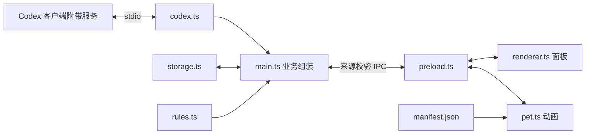

# 项目架构

程序使用 Electron 主进程管理窗口、托盘、配置和 Codex 子进程；渲染进程只负责界面和动画。两者通过受限 preload 桥通信，渲染进程没有 Node.js 权限。

| 模块 | 职责 |
| --- | --- |
| main.ts | 窗口、托盘与通知编排，服务组装和业务状态 |
| storage.ts | 旧配置校验、损坏备份、原子保存 |
| codex.ts | 客户端服务定位、握手、请求映射、超时及进程清理 |
| rules.ts | 额度标准化、阈值去重、北京时间规则与设置校验 |
| scheduler.ts / windows.ts | 调度器生命周期、可见性及缩放几何 |
| ipc.ts / preload.ts / types.ts | 来源校验、白名单桥、共享接口 |
| privacy.ts | 账号遮罩及诊断脱敏 |
| renderer.ts | 额度、设置和实时缩放界面 |
| pet.ts / manifest.ts | 动画状态机、缓存、命中检测及清单校验 |

核心动作为 idle、run-left、laugh、glance，右跑通过镜像实现；stretch 兼容映射到待机。bridges 提供进入、退出和转身的中间姿势，切换等待合法收尾帧，窗口位置则立即跟随指针。大笑开启声音时以音频位置同步，静音时使用帧时长。

核心素材预加载，过渡素材按需加载并限制缓存。路径越界和非法时长被拒绝；缺失过渡安全跳过，核心素材缺失则显示提示。增加动作需同步类型、清单和状态机。

主进程维护设置、额度和提醒去重记录；公开快照不包含账号内部标识。退出清理调度器、拖动定时器、IPC 和子进程。主进程仍保留托盘和通知编排，避免过度抽象。

连接仅允许客户端安装目录，不使用独立 CLI、npm 或 PATH 回退。每次额度检查重新连接服务以读取最新共享登录状态；登录和切换账号由客户端完成。preload 不再暴露 login，主进程也不注册登录 IPC。

桌宠启动独立于额度连接：Windows 登录任务启动奶蛙，desktop-monitor.ts 每 5 秒检测桌面会话。主进程在客户端出现时刷新，消失时停止子进程并标记旧数据；请求结果返回后再次核对会话，避免关闭客户端后的旧结果覆盖等待状态。
